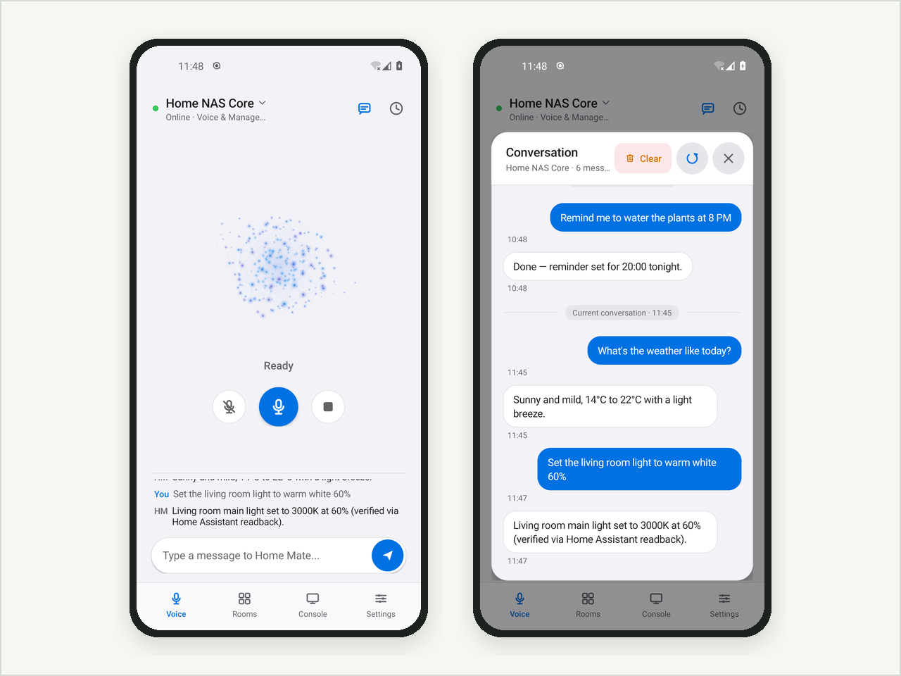
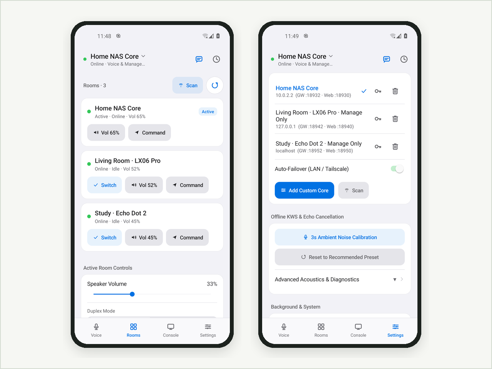
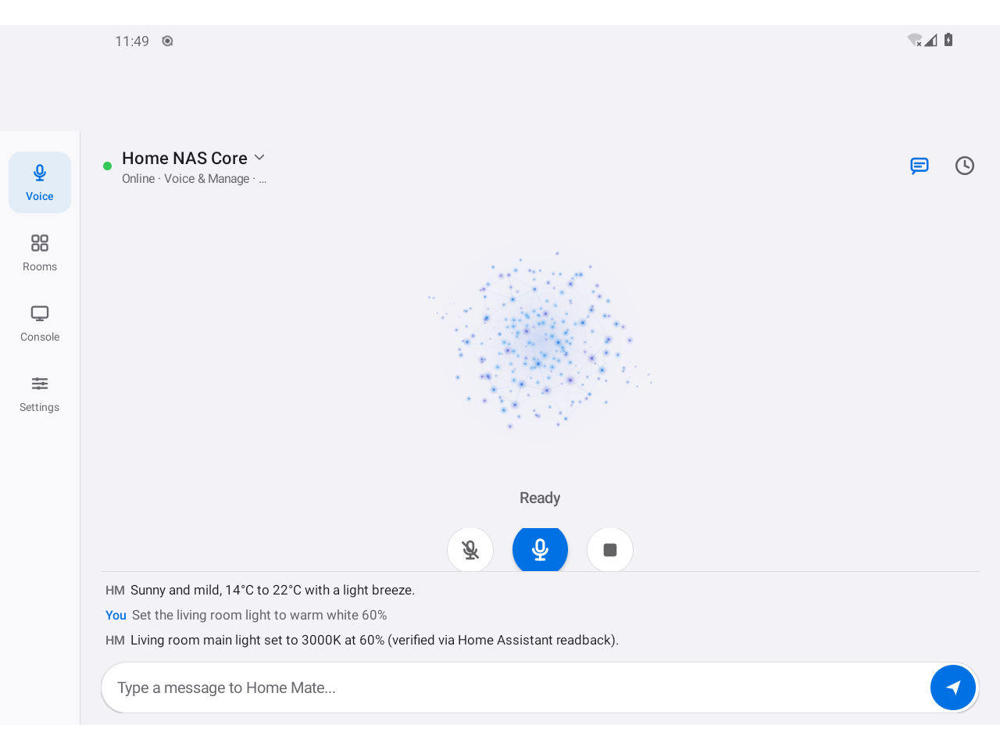
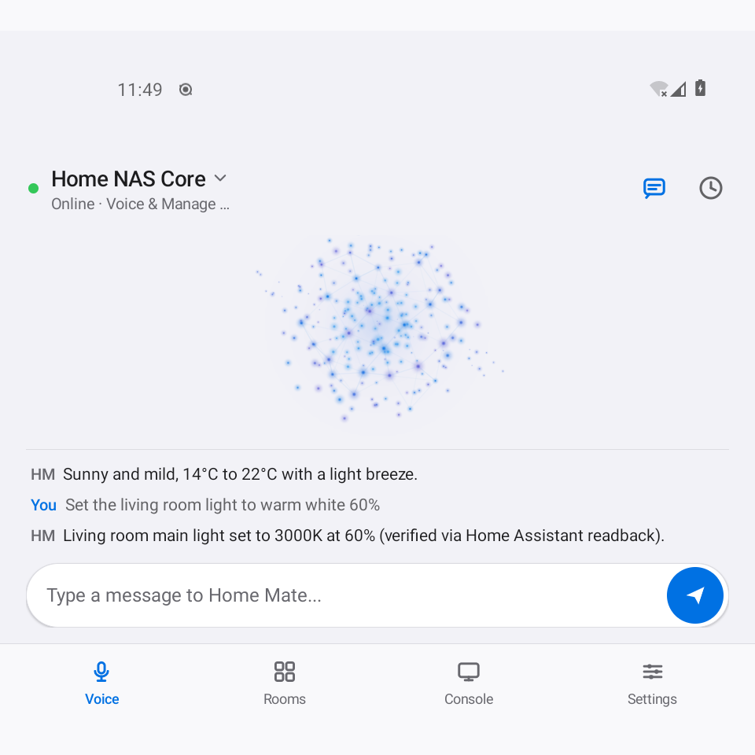

<div align="center">
  <h1>Home Mate Android Universal Client &amp; Voice Gateway</h1>
  <p>
    <strong>One Adaptive APK Turning Android Smart Displays, 86 Wall Panels, Tablets, Phones &amp; Repurposed Spare Phones into Home Mate Voice Terminals</strong>
  </p>
  <p>
    <a href="README.md"><strong>English</strong></a> ·
    <a href="README.zh-CN.md">简体中文</a> ·
    <a href="https://mymate.homes">Official Website (mymate.homes)</a>
  </p>
  <p>
    
    
    
    
  </p>
</div>

---

## Ecosystem Position & Prerequisites

This repository is the **Universal Adaptive Android Client & Voice Gateway** in the unified 3-repository **Home Mate** ecosystem:

| Repository | Role | Relationship |
| :--- | :--- | :--- |
| **[`yes999zc/home-mate`](https://github.com/yes999zc/home-mate)** | Sovereign Core Brain (`hm-core` + Vue 3 Console + Master Brain orchestration) | **Required prerequisite**: run at least one `hm-core` (Full Docker on NAS/server, or on-speaker) |
| **[`yes999zc/home-mate-gateway-linux`](https://github.com/yes999zc/home-mate-gateway-linux)** | Unified Linux hardware gateway (Echo Dot 2 + Xiaomi LX06 256 MB / 128 MB) | Peer hardware speakers managed together in the Android Whole-House tab |
| **`yes999zc/home-mate-gateway-android`** *(this repo)* | Universal adaptive zero-dependency Android APK | Connects over private LAN or Tailscale as both a far-field voice endpoint and a multi-room controller |

### Prerequisites on `hm-core`
1. **A running `hm-core` instance**:
   - **Full Voice + Management Mode (NAS / Server Docker)**: Ensure `:8930` (HTTP API), `:8932` (Northbound v2 gateway with `HM_GATEWAY_ALLOW_LAN=1`), and `:8933/udp` (LAN auto-discovery) are reachable on your LAN or Tailscale.
   - **Manage-Only Mode (On-Speaker Core)**: When pointing at an embedded speaker running loopback-only `:8932`, the app automatically runs cleanly in Manage-Only mode (text commands, room playback controls, unified history & embedded Web Console without reconnect spam).
2. **Authentication (Choose One)**:
   - **Household Bearer Token (Recommended)**: Generate a token in the `hm-core` Web Console (`:8930`) and paste it into the Core profile card in the app.
   - **LAN Trusted Exemption (`lan_gateway_exempt`)**: Opt-in setting in `hm-core` Security Settings allowing unauthenticated everyday voice/reading from RFC 1918 LAN & Tailscale (`100.64.0.0/10`) while keeping high-risk admin actions Bearer-gated.

---

## Live Adaptive Screenshots (Phone 4:3 · Smart Display 4:3 · 86 Wall Panel 1:1)

<table>
  <tr>
    <td width="50%">
      
      <p align="center"><strong>1. Voice Companion &amp; Unified History Clear (4:3)</strong><br>3D nebula orb, bottom live ticker synced with top-right history sheet &amp; one-tap Clear (current + archived)</p>
    </td>
    <td width="50%">
      
      <p align="center"><strong>2. Whole-House Control &amp; Settings (4:3)</strong><br>Multi-room Core switching, Kiosk 86-panel mode, battery exemption management &amp; GitHub Releases updater</p>
    </td>
  </tr>
  <tr>
    <td width="50%">
      
      <p align="center"><strong>3. Smart Display &amp; Tablet Layout (Native 4:3)</strong><br>Automatic left navigation rail for landscape smart displays, bedside stands &amp; tablets</p>
    </td>
    <td width="50%">
      
      <p align="center"><strong>4. 4-Inch 86 Wall Control Panel (Native 1:1)</strong><br>Square compact layout + optional Kiosk Home Launcher for wall-mounted smart panels</p>
    </td>
  </tr>
</table>

---

## Which APK Should I Download? (3 Variants Explained)

All three variants share the exact same UI, protocol logic, and signing certificate (you can upgrade across variants in place without losing configuration). They differ only in whether the offline Sherpa-ONNX JNI wake-word engine is bundled:

> **Production Signing Key (`v2.3.18+`)**: Starting with `v2.3.18`, official Releases are signed with our dedicated 4096-bit RSA release certificate (`CN=Home Mate, O=Home Mate, C=US`, SHA-256: `CC:84:23:73:F1:63:D3:69:76:9B:21:59:D7:AD:CC:EC:0C:0E:86:96:B6:9C:E8:B8:77:8F:8D:83:AC:AF:81:B7`). If you are upgrading from `<= v2.3.17`, please **uninstall the older APK once** before installing `v2.3.18+` (all subsequent updates upgrade in place seamlessly).

| Variant | Size | Bundled Native Engine | Best For |
| :--- | :--- | :--- | :--- |
| **`full-arm64`** | **~13 MB** | `arm64-v8a` `libsherpa-onnx-jni.so` + WenetSpeech Zipformer int8 KWS model | **Modern 64-bit Android phones & tablets (Recommended)** — full hands-free offline wake word, smallest full package |
| **`universal`** (`hm.apk`) | **~21 MB** | Both **`arm64-v8a` + `armeabi-v7a`** JNI libraries + offline KWS model | **32-bit 86 wall panels, older Android displays/tablets, Phicomm R1, or when unsure of CPU architecture** |
| **`slim`** | **~225 KB** | Pure Java/DEX only (no offline KWS library or model) | **Ultra-lightweight remote controller** — whole-house switching, text chat, tap-to-talk & settings on storage-constrained devices |

---

## Adaptive Device Matrix

| Device Form Factor | Android Version | Highlights |
| :--- | :--- | :--- |
| **Phones & Foldables (including spare old phones)** | Android 8 ~ 16 | Bottom 4-tab layout (Voice / Rooms / Console / Settings), 3D nebula orb, hands-free offline KWS + mid-playback barge-in |
| **Android Smart Displays & Tablets** | Android 7 ~ 16 | Landscape left navigation rail, OLED StandBy bedside clock, live conversation ticker & whole-house media control |
| **4-Inch 86 Wall Control Panels (`1:1`)** | Android 6 ~ 11 | Square compact adaptive layout + opt-in **Kiosk Home Launcher** mode |
| **Screenless Android Speakers (e.g. Phicomm R1)** | Android 5.0 (API 21)+ | Foreground keep-alive service, battery optimization management & continuous far-field voice gateway *(install `universal` via `adb install -r hm.apk` and pair over `scrcpy` or ADB input)* |

---

## Key Capabilities

- **Zero-Friction Onboarding & Multi-Route Failover**: 1-tap UDP `:8933` LAN discovery + manual IP/Tailscale/Token setup; deduplicates LAN and Tailscale routes via `core_id` with automatic low-latency LAN preference.
- **Offline KWS & Mid-Playback PBFDAF AEC Barge-In**: Bundled Sherpa-ONNX Zipformer int8 JNI engine with mobile-calibrated `0.22 / 3.00` KWS defaults (isolated from Dot2/LX06 speaker globals), 1.6 s pre-onset ring buffer, and software PBFDAF AEC for interrupting speech/music mid-playback.
- **Unified Conversation History & One-Tap Clear**: Top-right history sheet displays both current and archived (`退下`) conversations; tapping **Clear** calls `DELETE /api/v0/devices/{id}/conversation` (`include_archived: true`, with legacy 400/422 fallback) and immediately clears the Home bottom ticker too.
- **Transparent Voice Mode Controls**: Stable half-duplex is the everyday default; **Full-Duplex is clearly labeled `Full Duplex (In Dev)`** with an explicit confirmation guard.
- **Background Keep-Alive Management**: Requests battery optimization exemption when off, and jumps directly to Android System App Info / Battery settings when already enabled so users can revoke or adjust it anytime.
- **GitHub Releases Auto-Updater**: Defaults to `https://api.github.com/repos/yes999zc/home-mate-gateway-android/releases/latest` with semver comparison and ABI-aware APK selection (`full-arm64` / `universal`), while also supporting custom LAN/NAS `version.json` mirrors.
- **Bilingual & Dual Theme**: Full English / Simplified Chinese switching and System / Light / OLED Dark themes.

---

## Copy-Paste AI Coding Agent Prompts

### Prompt A — Help Me Connect My Phone / Old Phone / 86 Panel to Home Mate Core
```text
Help me connect my Android device (phone / spare old phone / 86 wall panel / smart display) using Home Mate Android Universal Gateway (`https://github.com/yes999zc/home-mate-gateway-android`) to my Home Mate Core at 192.168.1.10:

1. Check `http://192.168.1.10:8930/api/v0/auth` and `/api/v0/status` to verify the Core is online, `HM_GATEWAY_ALLOW_LAN=1` is enabled on `:8932`, and UDP `:8933` discovery is reachable.
2. Tell me which APK variant to install from GitHub Releases (`full-arm64` for 64-bit phones/tablets, `universal` for 32-bit 86 wall panels/older devices, or `slim` for control-only).
3. Guide me through either pasting my household Bearer token into the Core profile card or enabling `lan_gateway_exempt` for trusted private LAN devices, and confirm the Android device appears online in `/api/v0/mode` with mobile KWS defaults (`0.22 / 3.00`).
```

### Prompt B — Build & Verify Signed APKs Locally
```text
Help me test and build the Home Mate Android Universal Gateway APKs locally in `home-mate-gateway-android`:

1. Verify JDK 17+ and `$ANDROID_HOME` (`build-tools` + `platforms/android-35` or `34`) are available.
2. Run `./tools/test_jvm.sh` and confirm all JVM unit & protocol regression tests pass.
3. Run `./tools/build_apk.sh` (for public release builds, configure a dedicated release keystore via `HM_ANDROID_KEYSTORE`, `HM_ANDROID_KEY_ALIAS`, `HM_ANDROID_KEYSTORE_PASS`, and `HM_ANDROID_KEY_PASS` — never ship public APKs signed with debug credentials).
4. Verify all generated APKs (`slim`, `full-arm64`, `universal`) pass `apksigner verify` and report exact file paths and sizes.
```

---

## Local Build & Verification

> Prerequisites: JDK 17+ and Android SDK (`ANDROID_HOME` with `build-tools/35.0.0` and `platforms/android-35`).

```bash
# 1. Run all JVM unit & protocol regression tests
./tools/test_jvm.sh

# 2. Build signed APKs (outputs slim, full-arm64, universal & hm.apk)
./tools/build_apk.sh

# For public release signing with your own release keystore:
# HM_ANDROID_KEYSTORE=/path/to/release.keystore \
# HM_ANDROID_KEY_ALIAS=homemate-release \
# HM_ANDROID_KEYSTORE_PASS=... HM_ANDROID_KEY_PASS=... \
# ./tools/build_apk.sh --release
```

---

## License

Aligned with [`yes999zc/home-mate`](https://github.com/yes999zc/home-mate):
- **Open Source**: **GNU Affero General Public License v3.0 (`AGPL-3.0-only`)** ([`LICENSE`](LICENSE)).
- **Northbound v2 Protocol Exception**: **Apache License 2.0** ([`LICENSE-PROTOCOL-APACHE-2.0`](LICENSE-PROTOCOL-APACHE-2.0); see [`LICENSING.md`](LICENSING.md)).
- **Commercial / OEM Licensing**: Contact `zhangcong1985@gmail.com` / `yes999zc@163.com` ([https://mymate.homes](https://mymate.homes)).
- Third-party notices: [`THIRD_PARTY_NOTICES.md`](THIRD_PARTY_NOTICES.md).
