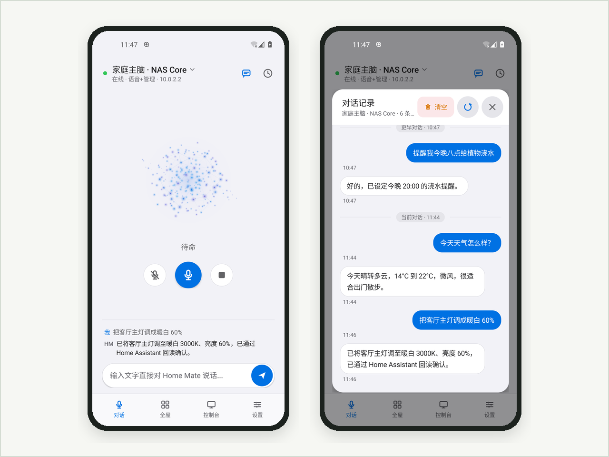
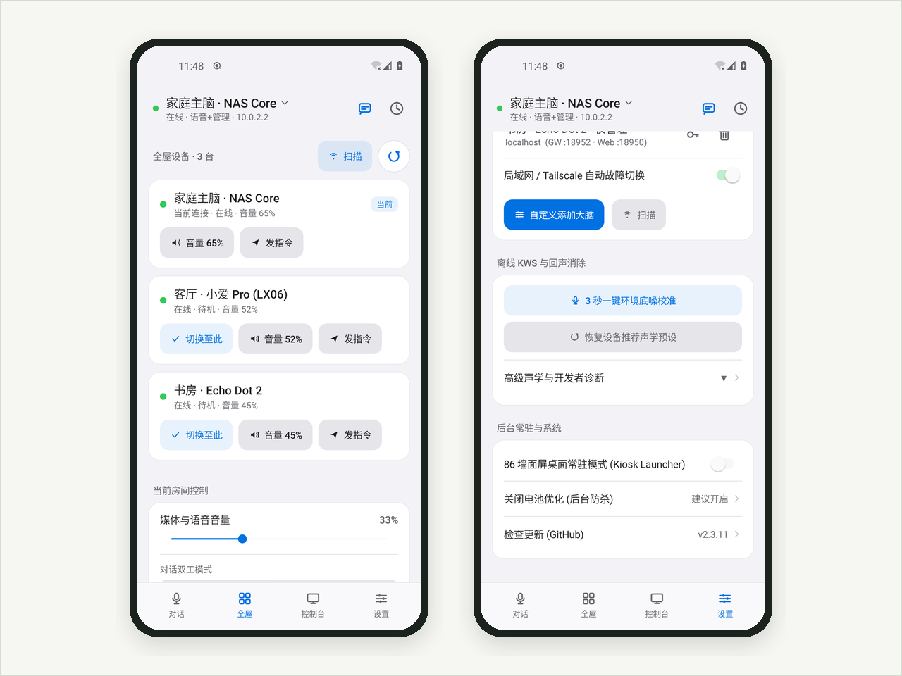
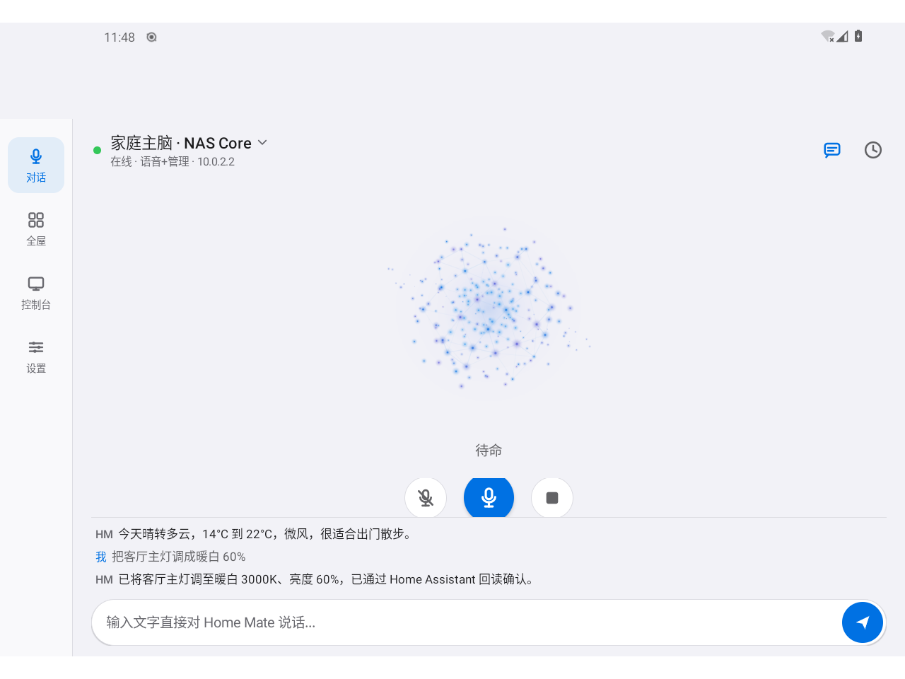
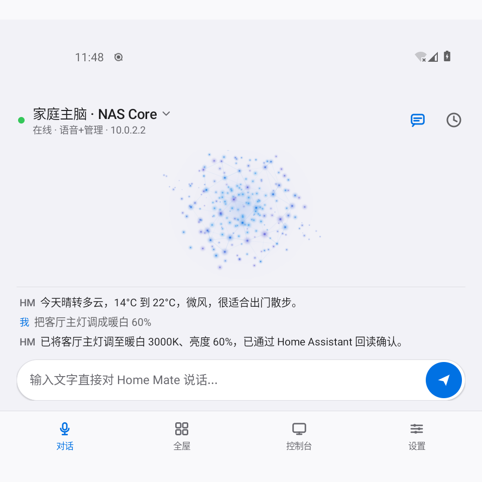

<div align="center">
  <h1>Home Mate Android 通用客户端与语音网关</h1>
  <p>
    <strong>一个自适应 APK，把安卓带屏音箱、4 寸 86 墙面控制面板、平板、主力机与废旧安卓手机秒变全屋 AI 语音终端</strong>
  </p>
  <p>
    <a href="README.md">English</a> ·
    <a href="README.zh-CN.md"><strong>简体中文</strong></a> ·
    <a href="https://mymate.homes">官方网站 (mymate.homes)</a>
  </p>
  <p>
    
    
    
    
  </p>
</div>

---

## 生态定位与使用前提

本仓库是 **Home Mate** 统一三仓开源生态中的 **Android 通用自适应客户端与语音网关**：

| 仓库 | 定位 | 关系 |
| :--- | :--- | :--- |
| **[`yes999zc/home-mate`](https://github.com/yes999zc/home-mate)** | 核心边缘大脑（`hm-core` + Vue 3 控制台 + 家庭主脑编排） | **必需前置条件**：需先在 NAS / Docker / 电脑或音箱上运行至少一台 `hm-core` |
| **[`yes999zc/home-mate-gateway-linux`](https://github.com/yes999zc/home-mate-gateway-linux)** | Linux 统一硬件语音网关（Echo Dot 2 + 小米 LX06 256MB / 128MB） | 家庭硬件音箱节点，可在 Android「全屋」页统一发现与控播 |
| **`yes999zc/home-mate-gateway-android`** *（本仓）* | Android 通用自适应零依赖 APK | 通过局域网或 Tailscale 接入 `hm-core`，兼具远场语音终端 + 全屋中控 |

### 接入前置条件
1. **一台运行中的 Home Mate Core（`hm-core`）**：
   - **完整语音 + 管理模式（推荐 NAS / 服务器全量 Docker）**：确保局域网或 Tailscale 可达 `:8930`（HTTP 控制台/API）、`:8932`（Northbound v2 语音网关，需开启 `HM_GATEWAY_ALLOW_LAN=1`）与 `:8933/udp`（一键自动发现）。
   - **仅管理模式（Manage-Only）**：若连接独立运行的音箱本体 Core（默认仅开放 `:8930`、`:8932` 仅回环监听），APP 自动以管理模式上线，支持文字对话、全屋控播与内嵌控制台，不刷重连告警。
2. **身份认证（二选一）**：
   - **家庭配对令牌（推荐）**：在 `hm-core` Web 控制台生成家庭管理员 Token，填入 APP 核心档案卡片。
   - **局域网可信设备免密豁免（`lan_gateway_exempt`）**：在 `hm-core`「安全设置」开启后，同局域网 RFC 1918 或 Tailscale（`100.64.0.0/10`）设备可免 Token 进行日常语音与对话查询（清空记录与高危管理操作仍严格校验管理员 Token）。

---

## 实机自适应界面截图（手机 4:3 · 带屏音箱 4:3 · 86 墙面屏 1:1）

<table>
  <tr>
    <td width="50%">
      
      <p align="center"><strong>1. 语音主页与统一对话历史清空（手机端 · 4:3）</strong><br>3D 粒子星云球、底部实时字幕条与右上角完整历史面板同步，一键清空当前与归档记录</p>
    </td>
    <td width="50%">
      
      <p align="center"><strong>2. 全屋多房间控播与设置页（手机端 · 4:3）</strong><br>多核心自由切换、86 墙面屏桌面常驻模式、后台防杀管理与 GitHub Releases 自动更新</p>
    </td>
  </tr>
  <tr>
    <td width="50%">
      
      <p align="center"><strong>3. 带屏音箱 / 平板横屏布局（原生 4:3）</strong><br>自动切换左侧导航栏，适配安卓带屏音箱、桌面支架平板与床头时钟</p>
    </td>
    <td width="50%">
      
      <p align="center"><strong>4. 4 寸 86 墙面控制面板（原生 1:1）</strong><br>方屏紧凑排布 + 可选 Kiosk Launcher 桌面常驻，让墙面屏一秒接入全屋语音</p>
    </td>
  </tr>
</table>

---

## 3 个版本 APK 怎么选？（作用与区别一目了然）

三个安装包**界面与业务代码完全一致**，且使用同一把签名证书（彼此可直接覆盖升级，不丢配置），唯一区别在于是否打包本地离线唤醒引擎（Sherpa-ONNX JNI 原生库 + 中文 KWS 模型）与 CPU 架构：

| 版本 | 体积 | 内置原生组件 | 适用设备 / 推荐场景 |
| :--- | :--- | :--- | :--- |
| **`full-arm64`** | **~13 MB** | 64 位 `arm64-v8a/libsherpa-onnx-jni.so` + 离线 KWS 模型 | **现代 64 位安卓手机 / 平板首选**——支持免提离线语音唤醒，体积比通用包小 8 MB |
| **`universal`**（`hm.apk`） | **~21 MB** | 同时含 **64 位 `arm64-v8a` + 32 位 `armeabi-v7a`** 原生库 + 离线 KWS 模型 | **32 位 86 墙面屏、老旧安卓平板、斐讯 R1，或不确定设备架构时闭眼选它** |
| **`slim`** | **~225 KB** | 纯 Java/DEX（不含本地离线唤醒引擎与模型） | **极轻量纯控制端**——支持全屋切控、文字对话、点击按钮语音与设置，适合存储极紧或不需要随时喊唤醒词的设备 |

---

## 全品类安卓设备自适应矩阵

| 设备形态 | 系统要求 | 自适应布局与特性 |
| :--- | :--- | :--- |
| **主力手机 / 折叠屏 / 闲置废旧安卓手机** | Android 8 ~ 16 | 底部 4-Tab（对话 / 全屋 / 控制台 / 设置）、3D 星云球、免提离线唤醒与播中打断，让旧手机重获新生 |
| **安卓带屏智能音箱 / 桌面平板** | Android 7 ~ 16 | 横屏左侧导航栏、OLED 纯黑 StandBy 床头时钟、实时对话字幕与全屋控播 |
| **4 寸 86 墙面智能控制面板（`1:1`）** | Android 6 ~ 11 | 方屏单页紧凑自适应 + 可选 **86 墙面屏桌面常驻模式（Kiosk Launcher）** |
| **无屏安卓音箱（斐讯 R1 等）** | Android 5.0 (API 21)+ | 前台保活服务、电池优化豁免管理与 24/7 远场语音网关 *（用 `adb install -r hm.apk` 安装 `universal` 版，并通过 `scrcpy` 投屏完成首次配对）* |

---

## 核心特性

- **零配置开箱与多路由故障切换**：UDP `:8933` 一键扫描局域网核心 + 手动添加 IP/域名/Tailscale；按 `core_id` 自动合并局域网与 Tailscale 双路由，网络恢复时优先回切低延迟局域网。
- **离线 KWS + 播中 PBFDAF 回声消除打断**：内置 Sherpa-ONNX Zipformer int8 JNI 唤醒引擎，采用独立手机端灵敏度默认基线（`0.22 / 3.00`，不被 Dot2/LX06 音箱全局参数覆盖），1.6 秒唤醒前滚缓冲 + 软件 PBFDAF AEC，支持播报与播放音乐中途直接语音打断。
- **统一对话记录与一键清空联动**：右上角「对话记录」完整呈现当前与「退下」归档的历史对话；点击 **「清空」** 调用 `DELETE /api/v0/devices/{id}/conversation`（`include_archived: true`，自动兼容旧版 Core），右上角记录与首页底部字幕条同步清空。
- **双工模式透明标识**：日常默认稳定的半双工模式；**全双工明确标注「全双工（开发中）」**并附带二次确认提示，避免误解。
- **后台防杀（电池优化）可开可关**：未豁免时一键申请白名单；已开启后再次点击会直接跳转系统应用详情 / 电池优化管理页并给出操作提示，方便随时关闭或调整。
- **GitHub Releases 自动更新**：默认检查 `https://api.github.com/repos/yes999zc/home-mate-gateway-android/releases/latest`，按设备 64/32 位 ABI 自动匹配 `full-arm64` / `universal` 安装包，同时兼容自定义局域网/NAS `version.json` 镜像源。
- **双语与三态主题**：100% 简体中文 / English 实时切换，支持跟随系统 / 浅色白天 / OLED 深色夜间。

---

## AI 编程助手一键接入与编译提示词

### 提示词 A：零基础接入我的手机 / 废旧手机 / 86 墙面屏
```text
请帮我把 Home Mate Android 通用端（https://github.com/yes999zc/home-mate-gateway-android）连接到我局域网 192.168.1.10 的 Home Mate Core：

1. 检查 `http://192.168.1.10:8930/api/v0/auth` 与 `/api/v0/status`，确认 Core 在线、已开启 `HM_GATEWAY_ALLOW_LAN=1` 监听 `:8932`，且 UDP `:8933` 发现广播可用。
2. 按我的设备帮我选好对应 APK（64 位手机/平板选 `full-arm64`，32 位 86 墙面屏/老平板选 `universal`，仅遥控选 `slim`）。
3. 指导我在 APP 核心卡片中填入家庭配对令牌（或按需开启局域网免密豁免 `lan_gateway_exempt`），并核对 `/api/v0/mode` 中手机设备已在线且灵敏度保持独立的 `0.22 / 3.00`。
```

### 提示词 B：开发者本地测试与编译签名 APK
```text
请帮我在 `home-mate-gateway-android` 仓库执行本地测试与签名 APK 构建：

1. 确认环境具备 JDK 17+ 与 `$ANDROID_HOME`（已安装 `build-tools` 与 `platforms/android-35` 或 `34`）。
2. 运行 `./tools/test_jvm.sh` 并确认全部 JVM 单元与协议回归测试通过。
3. 运行 `./tools/build_apk.sh`（若用于对外公开发布，务必通过 `HM_ANDROID_KEYSTORE`、`HM_ANDROID_KEY_ALIAS`、`HM_ANDROID_KEYSTORE_PASS`、`HM_ANDROID_KEY_PASS` 传入正式签名证书，严禁使用调试口令证书发公版）。
4. 确认产出的 `slim`、`full-arm64`、`universal` 三个 APK 全部通过 `apksigner verify` 并汇报文件路径与大小。
```

---

## 本地构建与测试

> 环境要求：JDK 17+ 与 Android SDK（`ANDROID_HOME` 含 `build-tools/35.0.0` 与 `platforms/android-35`）。

```bash
# 1. 运行全部本地 JVM 单元与北向协议回归测试
./tools/test_jvm.sh

# 2. 编译并签名全部 3 个版本 APK（输出 slim / full-arm64 / universal 与 hm.apk）
./tools/build_apk.sh

# 对外公开发布正式签名示例：
# HM_ANDROID_KEYSTORE=/path/to/release.keystore \
# HM_ANDROID_KEY_ALIAS=homemate-release \
# HM_ANDROID_KEYSTORE_PASS=... HM_ANDROID_KEY_PASS=... \
# ./tools/build_apk.sh --release
```

---

## 许可协议

与 [`yes999zc/home-mate`](https://github.com/yes999zc/home-mate) 保持统一双许可模型：
- **开源使用**：**GNU Affero General Public License v3.0 (`AGPL-3.0-only`)**（[`LICENSE`](LICENSE)）。
- **北向 v2 协议例外**：**Apache License 2.0**（[`LICENSE-PROTOCOL-APACHE-2.0`](LICENSE-PROTOCOL-APACHE-2.0)，详见 [`LICENSING.md`](LICENSING.md)）。
- **商业授权 / OEM 预装**：请联系 `zhangcong1985@gmail.com` / `yes999zc@163.com`（官网：[https://mymate.homes](https://mymate.homes)）。
- 第三方开源组件与模型致谢见 [`THIRD_PARTY_NOTICES.md`](THIRD_PARTY_NOTICES.md)。
